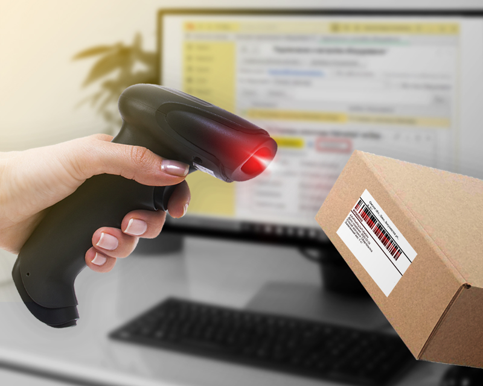

# Инструкция по решению проблем (Troubleshooting)

В этом разделе собраны решения для типичных ошибок, с которыми сталкиваются пользователи системы «СкладПро».

## Проблема: Маркировка товара не сканируется

Если сканер не считывает штрих-код, выполните следующие шаги:

1. Протрите стекло сканера мягкой сухой тканью.
2. Убедитесь, что штрих-код на товаре не поврежден.
3. Проверьте, горит ли на сканере зеленая лампочка (если нет — проверьте подключение USB).
4. Попробуйте просканировать товар под другим углом.

## Таблица типичных ошибок

| Код ошибки | Описание | Что делать |
| :--- | :--- | :--- |
| `ERR-01` | Нет связи с сервером | Проверьте интернет-кабель или настройки Wi-Fi |
| `ERR-02` | Товар не найден | Убедитесь, что товар добавлен в базу знаний |
| `ERR-03` | Ошибка базы данных | Перезагрузите компьютер и попробуйте снова |

## Если ничего не помогло
Если проблема не решена, обратитесь в службу поддержки по телефону 8-800-XXX-XX-XX или напишите нам на почту support@skladpro.ru.
